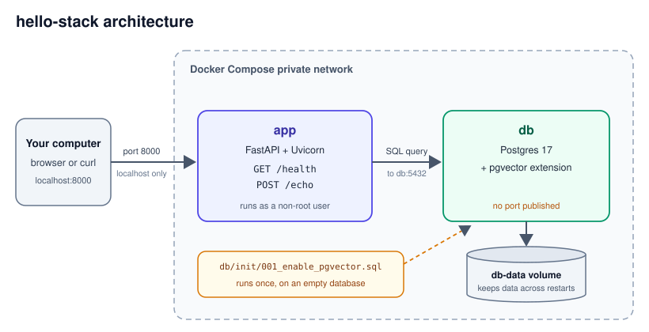

# hello-stack

A skeleton service: FastAPI and Postgres with pgvector, running together in Docker Compose.

## Run it

You only need [Docker](https://docs.docker.com/get-docker/).

```bash
docker compose up --build
```

Then, from another terminal:

```bash
curl http://localhost:8000/health
```

```bash
curl -X POST http://localhost:8000/echo -H 'Content-Type: application/json' -d '{"message": "hello"}'
```

Interactive API docs are at http://localhost:8000/docs.

## Endpoints

| Endpoint | Purpose |
| --- | --- |
| `GET /health` | Returns 200 if the database answers and pgvector is installed, otherwise 503 |
| `POST /echo` | Returns the `message` you send (1 to 1000 characters) |

## Architecture



Only the app is published, on `localhost:8000`. The database has no published port, so only containers in the stack can reach it. Its data is kept in the `db-data` volume, and the setup script enables pgvector the first time the database starts.

## Configuration

It runs without any setup, using local-only defaults. To change them, copy `.env.example` to `.env`
and edit it. `.env` is ignored by Git, so never commit real secrets.

The database is only reachable from inside Compose, and the app port is bound to your own machine.

## Develop

Requires [uv](https://docs.astral.sh/uv/). The tests don't need Docker.

```bash
uv sync
```

```bash
uv run pytest
```

```bash
uv run ruff check .
```

## Reset the database

The pgvector setup script only runs on an empty database. This deletes all stored data:

```bash
docker compose down --volumes
```
